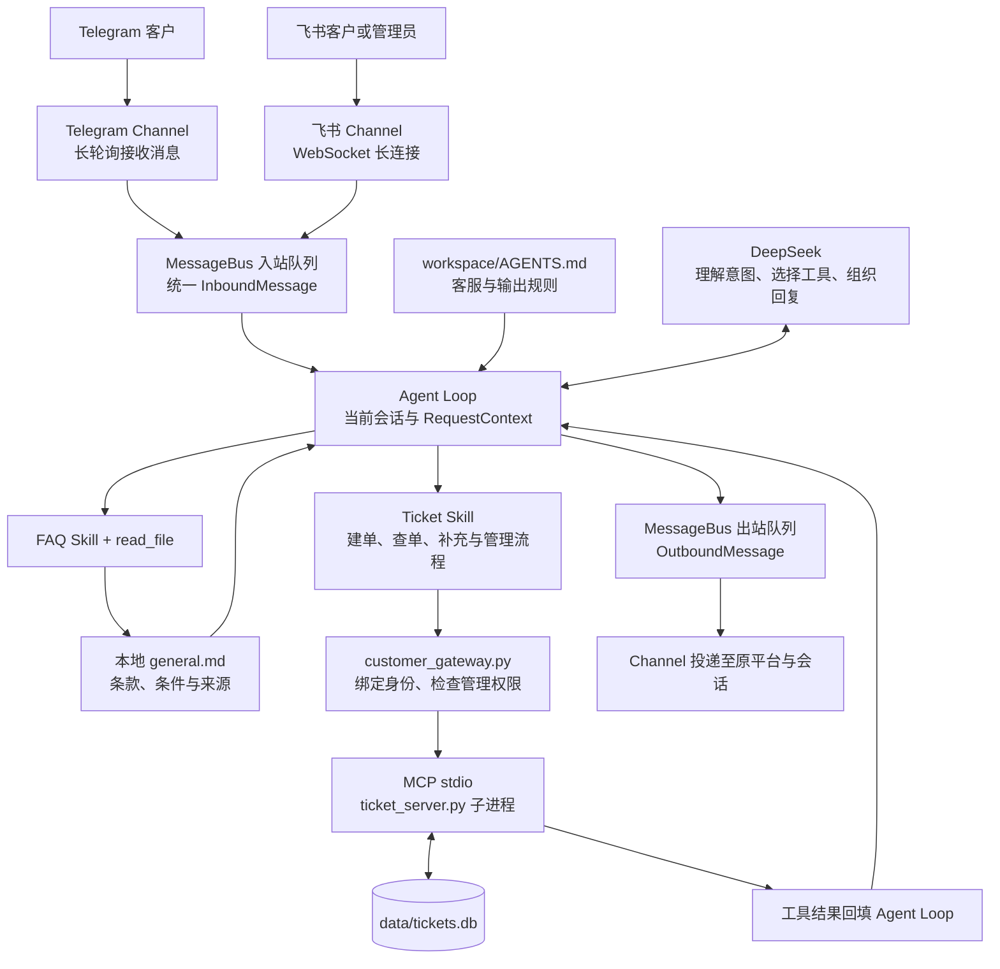
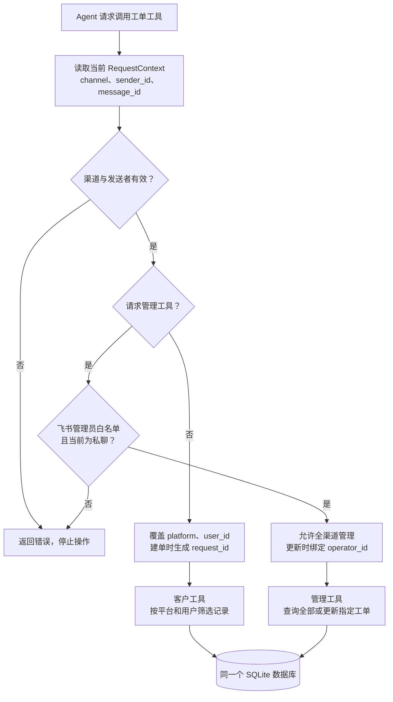

# EchoBridge 多平台智能客服系统

Telegram 与飞书接待客户，飞书管理员统一处理售后工单。

基于 Nanobot 的零售售后 Agent 实战项目。客户可以咨询商品与售后规则、确认创建工单、补充信息和查询进度。处理人员在飞书私聊中查看跨渠道待办、更新状态并添加处理备注，客户再次查询时获得最新结果。

当前已完成双平台真实会话联调，自动化测试覆盖 12 个测试方法。运行需要自行配置模型和平台凭据、准备知识库并完成机器人授权。

## 使用场景与当前进度

| 场景 | 当前能力与验证情况 |
| --- | --- |
| 知识库问答 | 按 FAQ Skill 读取本地 Markdown，结合适用条件回答并引用公开来源；已完成实际渠道问答验证 |
| 用户确认建单 | 整理商品、现象、已尝试步骤和诉求，用户确认后创建本项目的支持工单；Telegram 与飞书均已建单 |
| 客户查询 | 按真实渠道和发送者筛选本人记录，支持查询状态及补充备注 |
| 飞书集中处理 | 管理员私聊查询所有平台工单、查看详情、更新状态和添加客户可见备注；已验证处理 Telegram 来源工单 |
| 权限控制 | 项目入口绑定身份并校验管理员；已在真实 Telegram 会话中验证跨用户查询和冒充管理员被拒绝 |
| 客户输出 | 关闭渠道过程提示及流式展示，以规则约束工具名、路径和内部权限信息外露；自然语言输出需持续验收 |
| 数据持久化 | SQLite 保存工单及处理记录，已有记录重新打开及旧表迁移有自动化测试 |

## 系统如何工作

### 消息从用户到回复的完整链路

Nanobot 提供 Channel、MessageBus 和 Agent Loop。本项目增加客服规则、Skills、工单服务，以及工单工具的可信身份绑定。



MessageBus 使用 Nanobot 进程内的异步队列。Channel 负责平台消息格式转换，Agent Loop 将工具结果加入上下文后继续决策，最后通过出站队列回复。数据库保存业务事实，会话历史帮助理解追问。

Skill 由模型读取，用于指导操作顺序和判断条件。身份绑定、权限拒绝及数据库写入由程序执行。相同问题的知识内容已经位于会话上下文时，后续回答可能复用已有内容。

### 工单身份与管理员权限



模型的工具参数中隐藏 platform、user_id、operator_id 和建单 request_id。项目入口从当前请求覆盖身份字段，即使调用参数试图指定其他用户，也会按真实发送者执行。角色查询工具返回当前请求的访问范围，帮助 Agent 在本人列表与全渠道列表之间选择。

管理员名单由本地环境变量 TICKET_ADMIN_FEISHU_IDS 配置。管理员工具在每次执行前校验飞书渠道、发送者和私聊条件。普通客户通过本人查询读取状态与公开处理备注。

## 项目目录与文件职责

下面展示 GitHub 已提交的主要代码、配置模板和测试文件，路径相对于项目根目录。

```text
nanobot-customer-support/
├── customer_gateway.py             # gateway 启动入口、身份绑定与管理员权限校验
├── config.example.json             # 脱敏的模型、渠道、workspace 与 MCP 配置模板
├── .env.example                    # 密钥和管理员环境变量的占位模板
├── requirements.txt                # 固定依赖版本
├── README.md                       # 项目介绍与架构说明
├── .gitignore                      # 本地配置、密钥和运行数据排除规则
├── mcp_servers/
│   └── ticket_server.py            # 工单 MCP 服务、SQLite 存储与人工管理 CLI
├── tests/
│   ├── test_ticket_server.py       # 协议、数据库、幂等与并发测试
│   └── test_ticket_identity.py     # 身份隔离、管理员权限及集成测试
└── workspace/
    ├── AGENTS.md                   # 客服规则、输出规范和角色分流
    └── skills/
        ├── faq/SKILL.md            # 知识库读取、来源引用和人工升级流程
        └── ticket/SKILL.md         # 客户查询、建单及管理员处理流程
```

真实配置与密钥、知识库正文、工单数据库、聊天历史、配对记录、个人资料及日志在本地保存，已通过 Git 忽略规则排除。运行前需要自行填写配置模板并准备知识资料。

### 框架内部路径

以下路径属于已安装的 Nanobot 依赖，相对于 Python site-packages，可以用于定位消息处理流程。

| 框架路径 | 职责 |
| --- | --- |
| nanobot/channels/telegram/runtime.py | Telegram 收发与消息适配 |
| nanobot/channels/feishu/runtime.py | 飞书长连接、事件和回复适配 |
| nanobot/channels/manager.py | 渠道管理、出站分发及过程提示策略 |
| nanobot/bus/events.py | 入站和出站消息的数据结构 |
| nanobot/bus/queue.py | MessageBus 异步入站与出站队列 |
| nanobot/agent/loop.py | 上下文与模型、工具执行循环 |
| nanobot/agent/tools/context.py | 请求级上下文与发送者身份 |
| nanobot/agent/tools/mcp.py | MCP 连接、工具注册及调用包装 |

customer_gateway.py 在进程内扩展 MCPToolWrapper。升级依赖后需要重新执行身份集成测试，验证内部接口兼容性。

## MCP 工具与业务状态

启用管理能力后共注册 8 个工具，Nanobot 注册名带有 mcp_ticket_server_ 前缀。

| 工具 | 用途与范围 |
| --- | --- |
| get_ticket_access_context | 程序根据当前请求返回角色与查询范围 |
| create_ticket | 用户确认后创建工单，重试复用消息对应的幂等标识 |
| get_ticket | 查询当前渠道用户的指定工单 |
| list_user_tickets | 分页查询当前用户记录，可按状态过滤 |
| add_ticket_comment | 为本人工单追加客户说明 |
| admin_list_tickets | 飞书管理员私聊查询全部平台的工单 |
| admin_get_ticket | 飞书管理员查看指定工单详情 |
| admin_update_ticket | 飞书管理员更新状态或添加备注，记录处理人 |

工单包含标题、描述、分类、平台、用户、订单号、商品名、优先级、状态、时间与公开处理记录。分类覆盖退货、换货、退款、配送、破损、少件及其他问题。状态为 open、in_progress、resolved 和 closed。

create_ticket 在同一事务中检查 request_id 与内容指纹。相同请求返回原工单，内容冲突返回错误。更新备注使用写事务，避免并发读改写覆盖其他处理记录。追加备注在超时后需要先查询确认是否已经写入。

## 安全设计与测试

已实现的控制包括可信渠道身份绑定、客户工单范围隔离、飞书管理员私聊权限校验、SQL 参数化、建单幂等与事务更新。自动化测试同时检查伪造身份、越权管理和并发访问等场景。

当前共有 12 个测试方法，使用临时数据库、模拟渠道身份和真实 MCP stdio 子进程。在安装依赖的 Python 环境中执行测试。

```bash
python -m unittest discover -s tests -v
```

测试按以下流程组织，后续随功能补充具体用例和验收记录。

1. 工具与存储测试，检查输入、SQL 参数绑定、数据持久化、重试和并发一致性。
2. 身份与权限测试，检查客户、管理员及跨平台操作的访问范围。
3. 端到端链路测试，检查知识库回答、用户确认建单、人工处理、客户回查与重启后的记录恢复。
4. 对抗与输出测试，逐步补充提示注入、重复受限请求和内部信息外露场景。

当前已完成部分真实渠道联调。提示注入全面评估、客户自然语言输出及完整部署验收仍需完善，测试结论以实际用例覆盖范围为准。

## 部署与运行

部署说明将在 Docker 构建和验证完成后补充，届时填写经过验收的文件、路径、环境变量和运行命令。

### Docker 部署

将补充镜像构建和 Compose 配置，包含项目启动入口、环境变量注入、工单及会话等数据持久化挂载。运行配置需要适配容器内路径。

### Nginx 反向代理配置

是否配置 Nginx、HTTPS 证书及公开端口，根据最终 WebUI 或 HTTP 接口的访问需求确定。当前消息接入使用 Telegram 长轮询和飞书 WebSocket 长连接。

### 部署步骤

1. 准备知识库与本地配置，填写模型和平台凭据。
2. 构建镜像并配置持久化目录。
3. 启动容器，检查模型、渠道及 MCP 工具连接。
4. 验证客户建单、管理员处理和客户回查。
5. 重启或重建容器，核对工单和配对等运行数据。

具体命令与健康检查方式待容器化验收后补充。
