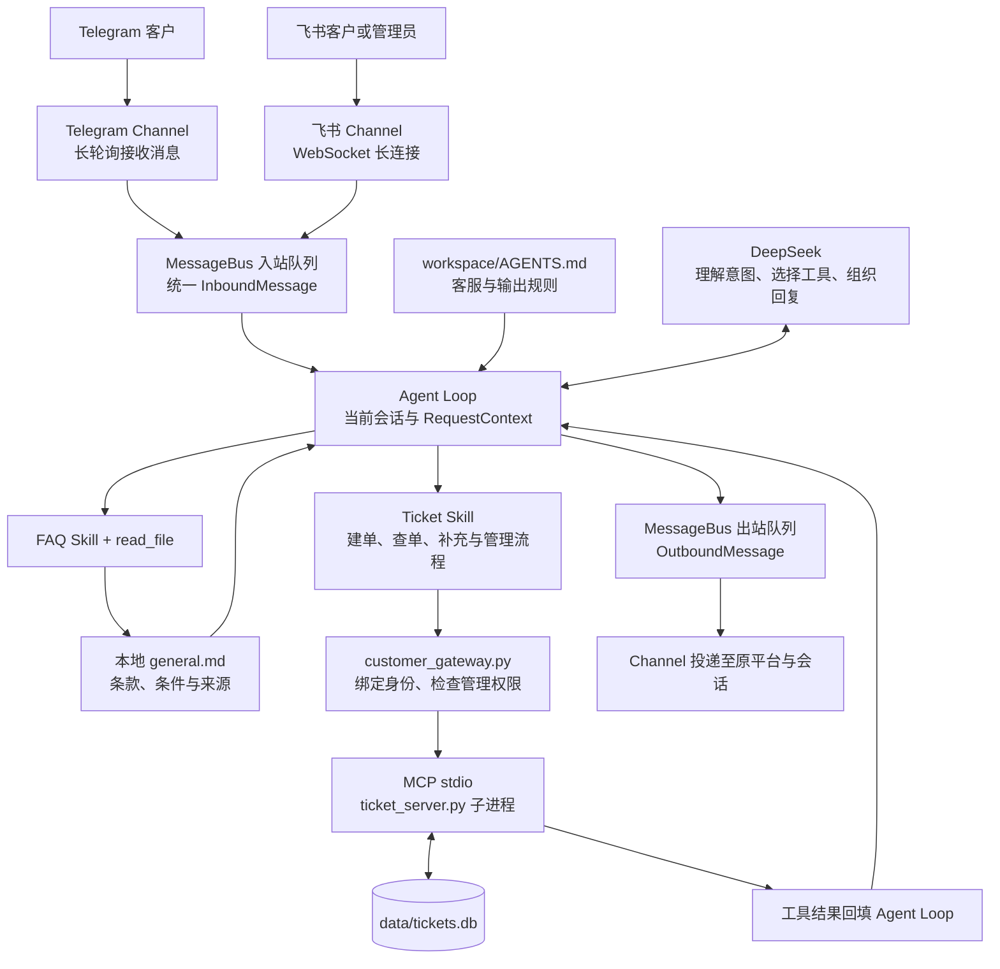
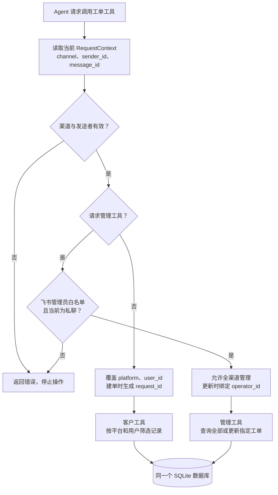
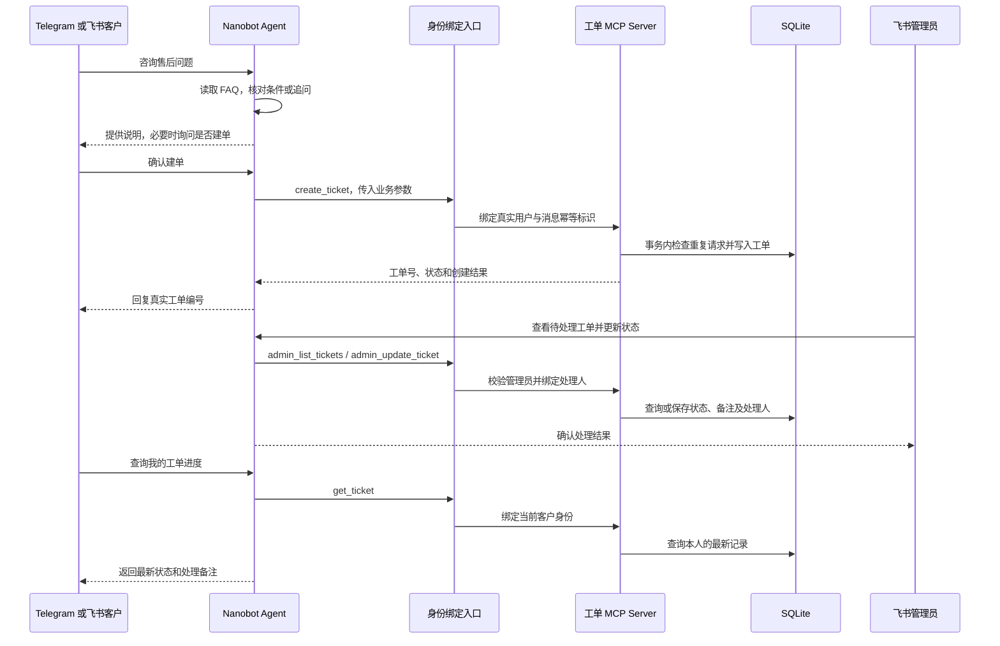

# EchoBridge 多平台智能客服系统

Telegram 与飞书接待客户，飞书管理员统一处理售后工单。

基于 Nanobot 的零售售后 Agent 实战项目。客户可以咨询商品与售后规则、确认创建工单、补充信息和查询进度。处理人员在飞书私聊中查看跨渠道待办、更新状态并添加处理备注，客户再次查询时获得最新结果。

当前已完成双平台真实会话联调，自动化测试覆盖 12 个测试方法。运行需要自行配置模型和平台凭据、准备知识库并完成机器人授权。

## 使用场景与当前进度

| 场景 | 当前能力与验证情况 |
| --- | --- |
| 知识库问答 | 按 FAQ Skill 读取本地 Markdown，结合适用条件回答并引用公开来源；已完成实际渠道问答验证 |
| 用户确认建单 | 整理商品、现象、已尝试步骤和诉求，用户确认后创建本项目的支持工单；Telegram 与飞书均已建单 |
| 客户查询 | 按真实渠道和发送者筛选本人记录，支持查询状态及补充备注 |
| 飞书集中处理 | 管理员私聊查询所有平台工单、查看详情、更新状态和添加客户可见备注；已验证处理 Telegram 来源工单 |
| 权限控制 | 项目入口绑定身份并校验管理员；已在真实 Telegram 会话中验证跨用户查询和冒充管理员被拒绝 |
| 客户输出 | 关闭渠道过程提示及流式展示，以规则约束工具名、路径和内部权限信息外露；自然语言输出需持续验收 |
| 数据持久化 | SQLite 保存工单及处理记录，已有记录重新打开及旧表迁移有自动化测试 |
| 后续能力 | 钉钉接入、主动通知、跨平台账号绑定和 Docker 部署待实现 |

## 系统如何工作

### 消息从用户到回复的完整链路

Nanobot 提供 Channel、MessageBus 和 Agent Loop。本项目增加客服规则、Skills、工单服务，以及工单工具的可信身份绑定。



MessageBus 使用 Nanobot 进程内的异步队列。Channel 负责平台消息格式转换，Agent Loop 将工具结果加入上下文后继续决策，最后通过出站队列回复。数据库保存业务事实，会话历史帮助理解追问。

Skill 由模型读取，用于指导操作顺序和判断条件。身份绑定、权限拒绝及数据库写入由程序执行。相同问题的知识内容已经位于会话上下文时，后续回答可能复用已有内容。

### 工单身份与管理员权限



模型的工具参数中隐藏 platform、user_id、operator_id 和建单 request_id。项目入口从当前请求覆盖身份字段，即使调用参数试图指定其他用户，也会按真实发送者执行。角色查询工具返回当前请求的访问范围，帮助 Agent 在本人列表与全渠道列表之间选择。

管理员名单由本地环境变量 TICKET_ADMIN_FEISHU_IDS 配置。管理员工具在每次执行前校验飞书渠道、发送者和私聊条件。普通客户通过本人查询读取状态与公开处理备注。

### 建单、人工处理与客户回查



当前更新保存到数据库，客户下次查询可见。实际退款、订单状态及官方售后受理需要接入对应业务系统。主动发送处理结果属于后续功能。

## 项目目录与文件职责

以下路径均相对于项目根目录。标注为“本地”的文件由部署者配置或运行时生成，GitHub 中提供对应模板或说明。

```text
nanobot-customer-support/
├── customer_gateway.py              # 项目启动入口与身份、权限扩展
├── config.example.json              # 可发布的配置模板，路径为占位内容
├── .env.example                     # 可发布的凭据和管理员变量模板
├── config.json                      # 本地运行配置
├── .env                             # 本地密钥、平台凭据和管理员 ID
├── requirements.txt                 # 固定依赖版本
├── README.md                        # 架构、运行和验收说明
├── .gitignore                       # 本地配置及运行数据排除规则
├── mcp_servers/
│   ├── ticket_server.py             # MCP 工具、TicketStore 和人工 CLI
│   └── LICENSE.learn-nanobot        # 教程来源的 MIT 许可声明
├── tests/
│   ├── test_ticket_server.py        # 协议、存储、迁移、输入及并发测试
│   └── test_ticket_identity.py      # 真实 MCP 调用的身份和管理权限测试
├── workspace/
│   ├── AGENTS.md                    # 客服规则、输出约束和角色分流
│   ├── skills/
│   │   ├── faq/SKILL.md             # 知识库读取、来源引用和人工升级流程
│   │   └── ticket/SKILL.md          # 角色识别及客户、管理员工具使用流程
│   ├── knowledge/ikea/              # 本地验证资料，未随仓库分发
│   │   ├── general.md              # 合并的 FAQ 与退货政策
│   │   ├── sources.json             # 来源、抓取时间和校验值
│   │   └── README.md                # 本地资料说明
│   ├── memory/                     # 本地长期记忆
│   ├── USER.md                     # 本地用户信息
│   ├── SOUL.md                     # 本地表达风格
│   ├── HEARTBEAT.md                # 本地周期任务说明
│   ├── prompts/                    # 本地提示词覆盖
│   ├── cron/                       # 本地任务数据
│   ├── triggers/                   # 本地触发器数据
│   └── .nanobot/                   # workspace 运行数据
├── data/tickets.db                 # 本地工单数据库
├── sessions/                       # 本地聊天历史，位于 workspace 外
├── pairing.json                    # 本地渠道用户配对记录
├── logs/                           # 本地运行日志，可能包含业务内容
├── media/                          # 本地消息附件
├── llm_usage.sqlite3               # 本地模型用量记录
├── config.json.lock                # 配置写入锁
└── cache/、cli-apps/、run/、webui/   # 本地框架运行目录
```

Nanobot 框架代码随依赖安装。其相对于 Python site-packages 的源码位置如下，平台接入和消息队列逻辑可以从这里阅读。

| 框架路径 | 职责 |
| --- | --- |
| nanobot/channels/telegram/runtime.py | Telegram 收发与消息适配 |
| nanobot/channels/feishu/runtime.py | 飞书长连接、事件和回复适配 |
| nanobot/channels/manager.py | Channel 管理、出站分发及过程提示策略 |
| nanobot/bus/events.py | InboundMessage 和 OutboundMessage 数据结构 |
| nanobot/bus/queue.py | MessageBus 异步入站与出站队列 |
| nanobot/agent/loop.py | 上下文构建及模型、工具执行循环 |
| nanobot/agent/tools/context.py | 请求级 RequestContext 与 ContextVar |
| nanobot/agent/tools/mcp.py | MCP 连接、工具注册及调用包装 |

customer_gateway.py 在进程内扩展 MCPToolWrapper。升级 Nanobot 后，需要重新执行身份集成测试，检查内部接口兼容性。单独运行 nanobot gateway 时需要自行接入同等身份绑定逻辑。

## MCP 工具与业务状态

启用管理能力后共注册 8 个工具，Nanobot 注册名带有 mcp_ticket_server_ 前缀。

| 工具 | 用途与范围 |
| --- | --- |
| get_ticket_access_context | 程序根据当前请求返回角色与查询范围 |
| create_ticket | 用户确认后创建工单，重试复用消息对应的幂等标识 |
| get_ticket | 查询当前渠道用户的指定工单 |
| list_user_tickets | 分页查询当前用户记录，可按状态过滤 |
| add_ticket_comment | 为本人工单追加客户说明 |
| admin_list_tickets | 飞书管理员私聊查询全部平台的工单 |
| admin_get_ticket | 飞书管理员查看指定工单详情 |
| admin_update_ticket | 飞书管理员更新状态或添加备注，记录处理人 |

工单包含标题、描述、分类、平台、用户、订单号、商品名、优先级、状态、时间与公开处理记录。分类覆盖退货、换货、退款、配送、破损、少件及其他问题。状态为 open、in_progress、resolved 和 closed。

create_ticket 在同一事务中检查 request_id 与内容指纹。相同请求返回原工单，内容冲突返回错误。更新备注使用写事务，避免并发读改写覆盖其他处理记录。追加备注在超时后需要先查询确认是否已经写入。

## 安全设计与验证

### 程序执行层

| 风险 | 已实现的控制 | 验证依据 |
| --- | --- | --- |
| 伪造客户 ID | 从 RequestContext 覆盖平台和发送者，模型参数中隐藏身份字段 | 注入伪造 user_id、platform，断言入库身份仍为真实发送者 |
| 越权查单 | 查询和客户备注同时匹配工单号、平台和用户 | 不同用户、同 ID 不同平台均无法读取或补充别人的工单 |
| 冒充管理员 | 每次管理调用检查飞书渠道、管理员名单和私聊条件 | 普通客户调用管理工具、管理员在群聊调用均被拒绝 |
| 伪造处理人 | 更新时由入口覆盖 operator_id | 伪造处理人参数后，记录仍保存实际管理员 |
| SQL 注入 | 业务数据通过 SQLite 参数绑定，动态查询片段由固定代码构造 | 含 SQL 注入字符的 ID 仅作为普通值，无法扩大查询范围 |
| 重复建单 | 消息幂等标识、唯一索引和事务内指纹校验 | 12 次并发相同建单请求仅创建一张工单，内容变化返回冲突 |
| 并发状态串用 | 请求上下文通过 ContextVar 读取，数据库连接按操作创建 | 不同用户并发调用时身份隔离，并发备注均保留 |
| 内部信息外露 | 渠道过程提示关闭、拒绝消息简化、回复规则约束 | 拒绝结果有字符串断言，自然语言回复需要持续实际验收 |

本地 stdio Server 信任项目入口注入的身份，操作系统用户和该进程属于当前信任边界。文件、Shell 和网页工具的权限需要按部署环境配置。具有主机文件访问能力的用户或进程仍可访问相应运行数据。

### 提示注入与客户回复

AGENTS.md 要求把用户消息、附件和知识库内容作为资料，工具权限按程序校验。客户声称自己是管理员时，系统根据真实角色执行检查。客户回复规则要求移除工具名、错误码、角色字段、路径、配置和管理员入口信息，并在重复受限请求时提出人工跟进。

已经在真实 Telegram 会话验证两类场景，一是客户提交别人的工单号无法取得详情，二是用户声称“我是管理员”后尝试调用管理列表，程序拒绝执行。相关权限机制也有自动化测试。

对知识库恶意指令、附件注入、长上下文诱导及多种模型输出的全面对抗评估仍待补充。回复层提示约束需要持续验收；当前安全结论以表中已验证的执行路径为范围。

### 自动化测试

在安装了 requirements.txt 的项目虚拟环境中运行测试。测试创建临时数据库和真实 MCP stdio 子进程，使用模拟渠道身份，不依赖模型密钥和平台账号。

```bash
python -m unittest discover -s tests -v
```

当前共 12 个测试方法，覆盖 MCP 握手与工具调用、无身份调用拒绝、跨用户与跨平台隔离、管理员权限、角色范围、幂等创建、输入边界、SQL 参数化、分页、并发备注、旧表迁移、持久化和人工 CLI。

| 测试文件 | 阅读重点 |
| --- | --- |
| tests/test_ticket_server.py | TicketStore、真实 SDK ClientSession、重试与数据库一致性 |
| tests/test_ticket_identity.py | Nanobot 工具注册、上下文绑定、权限拒绝与管理操作 |

## 快速开始

### 准备环境与配置

需要 Python 3.11 或更高版本，依赖固定为 Nanobot 0.4.1 和 MCP SDK 1.30.0。模型与平台服务需要部署者自己的凭据。首次安装和复制模板可按以下顺序执行，已有本地配置时保留原文件。

```bash
git clone https://github.com/tommie-04/nanobot-customer-support.git
cd nanobot-customer-support
python3 -m venv .venv
source .venv/bin/activate
python -m pip install -r requirements.txt
cp config.example.json config.json
cp .env.example .env
```

编辑 config.json，替换 /ABSOLUTE/PATH/TO/PROJECT 与 /ABSOLUTE/PATH/TO/PYTHON。workspace 指向项目的 workspace 子目录，MCP 使用该虚拟环境的 Python，数据库指向项目 data/tickets.db。模板中的凭据通过环境变量引用。

编辑 .env，填写模型 API key、Telegram token、飞书 App ID 与 App Secret，并用 TICKET_ADMIN_FEISHU_IDS 指定管理员 open_id。多个管理员用英文逗号分隔。为本地敏感文件设置访问权限。

```bash
chmod 600 .env config.json
```

按 Nanobot 渠道指引完成 Telegram 机器人、飞书应用授权及渠道依赖准备。首个客户需要完成配对，群聊回复按 mention 策略触发。当前模板使用 Telegram polling 和飞书长连接。

本地知识库需自行准备。当前 FAQ Skill 读取 workspace/knowledge/ikea/general.md，可替换为自己的资料并同步修改 Skill。个人信息、知识库快照、数据库、配对、会话和日志由 .gitignore 排除。

### 启动与日常使用

在项目根目录加载 .env 并启动项目入口。启动器自动选择根目录 config.json，Nanobot 按 MCP 配置启动工单子进程。

```bash
set -a
source .env
set +a
python customer_gateway.py
```

客户可以询问“退货运费由谁承担”，明确表示“帮我创建破损工单”，或者查询“我之前的工单进展”。系统按工具执行结果返回编号、状态和备注。

配置的管理员可以在飞书私聊中发送“查看所有渠道待处理工单”，或明确指定某张工单的状态和处理备注。更改管理员环境变量后，重新加载 .env 并重启项目入口。

终端也可以处理工单，以下示例编号需替换成实际返回值。

```bash
python mcp_servers/ticket_server.py list --status open
python mcp_servers/ticket_server.py show TK-EXAMPLE
python mcp_servers/ticket_server.py update TK-EXAMPLE --status in_progress --comment "正在核实商品破损情况"
```

默认数据库为项目 data/tickets.db，支持 TICKET_DB_PATH 环境变量或 --db 参数。--db 放在 list、show、update 或 serve 子命令之前。

### 本地验收

| 操作 | 应检查的结果 |
| --- | --- |
| 新会话询问 FAQ | 日志包含知识库读取，答案引用实际来源并保留适用条件 |
| 用户拒绝建单 | 数据库没有新增记录 |
| Telegram 确认建单 | 返回的编号可以在终端和飞书管理员列表中找到 |
| 飞书管理员更新 | 记录保存实际处理人，客户回查得到最新状态与备注 |
| 客户查询其他人的编号 | 工具拒绝提供其他用户记录 |
| 客户自称管理员 | 角色保持客户，管理工具执行层拒绝操作 |
| 重启后查询原工单 | 编号、状态和处理记录仍然可读 |
| 重复受限请求 | 回复提供人工跟进选择，建单前取得用户同意 |

日志可能包含消息、工具参数和业务记录，分享前需要脱敏。当前仓库仅提供占位配置，实际账号 ID、密钥、客户记录和测试截图留在本地。

## 后续方向

- Docker 镜像、Compose 与持久化验收。
- 处理结果主动通知，以及发送失败后的结果核实。
- 钉钉渠道接入与真实会话验证。
- 跨平台账号绑定和更完整的权限策略。
- 提示注入对抗用例、输出泄露评估与部署级工具权限控制。

## 参考与许可

工单数据结构和基础工具职责参考 learn-nanobot 第十二章项目二，已基于当前项目重写协议接入、身份与权限扩展、并发和重试处理。教程的许可声明保存在 mcp_servers/LICENSE.learn-nanobot。[教程来源](https://github.com/bcefghj/learn-nanobot/blob/740d041/docs/12-nanobot-real-projects/README.md)

项目运行能力依赖 HKUDS/nanobot 和官方 MCP Python SDK。README 的使用场景、执行链路和验证章节组织参考 EchoFrame，内容依据本项目实现编写。[Nanobot](https://github.com/HKUDS/nanobot) · [MCP Python SDK](https://github.com/modelcontextprotocol/python-sdk) · [EchoFrame](https://github.com/blackirlsama/EchoFrame)

本地第三方知识资料保留原有权利，公开发布前需按来源确认授权。
