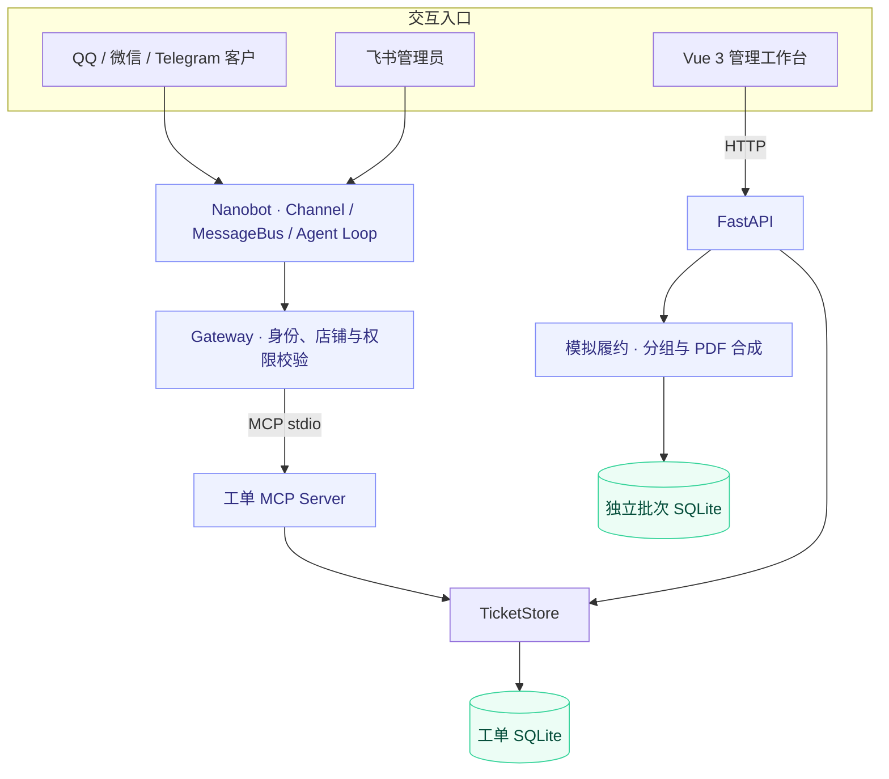
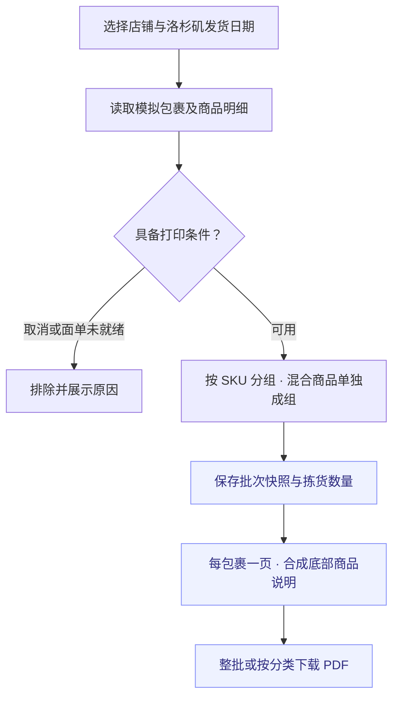
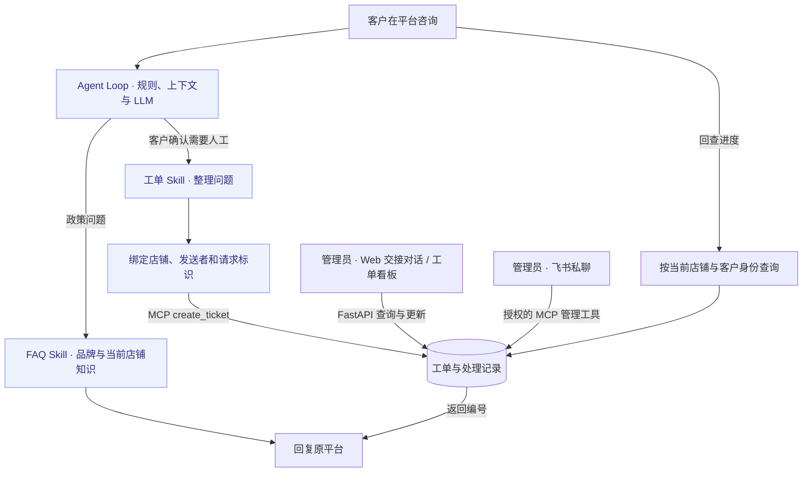

# EchoBridge · 多店铺履约与售后工作台

面向同一品牌旗下的 20 家美国 TikTok Shop，商品由洛杉矶共享仓发出。EchoBridge 将跨店铺面单整理、客服转人工和售后跟进集中到一个管理工作台。

**技术栈**　Python · Nanobot · MCP / FastMCP · FastAPI · Vue 3 · SQLite · ReportLab / pypdf

## 业务场景与解决的问题

| 日常问题 | 系统处理方式 |
|---|---|
| 同款商品分散在多个店铺，仓库需要逐店整理发货任务 | 按仓库 SKU 汇总包裹，生成分类打印批次与拣货数量 |
| 面单缺少仓库需要的商品说明 | 在预留底部区域追加本包裹的商品名称、SKU 和数量 |
| 多件或混合商品容易漏发，重复取单容易重复生成任务 | 区分商品件数与包裹页数，混合包裹独立分组，保存稳定批次快照 |
| 客服咨询与人工售后混杂，跨店跟进容易遗漏 | FAQ 处理常规咨询，需要人工时建单，管理员在交接对话或看板中处理 |

当前面单模块使用 **20 家美国店铺的模拟订单与 USPS 面单**，已实现分类、PDF 合成、下载及批次存储。模拟面单带有醒目标记，无有效邮资。客服渠道通过 Nanobot 接收消息，工单经 MCP 写入 SQLite；工单回放提供原有美西、美东、英国三店的六份示例交接。真实 TikTok Shop API、退货申诉提交和打印机执行尚未接入。

## 系统架构



Web 与渠道服务使用同一工单数据库路径时，可以查询同一份处理记录。面单模拟库独立保存批次快照。当前 Web 是本机管理入口，尚未加入员工登录与店铺授权。

## 跨店面单流程



前两家示例店共有 21 个可用包裹，黑色 `pad-blk` 为 5 件、橙色 `pad-org` 为 11 件、银色 `pad-sil` 为 5 件。全部 20 店包含 57 个可用包裹、93 件商品，同时覆盖多件同款与混合商品样本。重复选择同一日期和店铺返回同一批次，下载使用保存的快照。

## 客服转人工与管理员处理



管理员聊天框接收工单交接摘要，发送的处理意见保存为客户可见备注；看板支持筛选、查看详情和更新状态。客户在原渠道主动回查最新进度。飞书管理员由白名单和私聊上下文校验，客户工具的店铺与身份由 Gateway 注入。

Nanobot 提供模型循环、会话和记忆能力，工单服务提供业务工具。长期记忆适合通用背景与操作偏好，订单归属、状态和处理记录以业务数据库为准。

## 项目目录与职责

```text
nanobot-customer-support/
├── customer_gateway.py          # 渠道 Gateway 入口、可信身份与店铺绑定
├── shop_registry.py             # 渠道实例与店铺配置解析
├── shops.json                   # 客服演示店铺、渠道与知识文件映射
├── api_service.py               # 店铺、工单和知识库 HTTP 接口
├── web_server.py                # FastAPI / 静态页面启动入口
├── start_web.sh                 # 本地 Web 启动脚本
├── fulfillment_simulator.py     # 20 店模拟包裹、SKU 分组、面单 PDF 合成
├── fulfillment_api.py           # 模拟批次接口与 SQLite 快照存储
├── demo_handoffs.py             # 通过真实 MCP 回放示例交接
├── mcp_servers/
│   └── ticket_server.py          # FastMCP 工具、TicketStore、工单 SQLite 与 CLI
├── static/
│   ├── index.html               # Vue 管理看板、管理员对话、面单打印页
│   ├── vue.global.prod.js       # 本地 Vue 运行库
│   └── tailwind-3.4.17.js       # 本地样式运行库
├── workspace/
│   ├── AGENTS.md                # 客服规则、输出规范与角色分流
│   ├── skills/faq/SKILL.md      # 知识查询与人工升级指导
│   ├── skills/ticket/SKILL.md   # 工单创建、查询与管理员处理指导
│   └── knowledge/
│       ├── brand/common.md      # 品牌通用政策
│       └── shops/               # 客服演示店铺专属政策
├── config.example.json          # 脱敏的渠道、模型、workspace 与 MCP 模板
├── .env.example                 # 密钥与管理员变量占位模板
├── requirements.txt             # Python 基础依赖与 PDF 库
├── requirements-docker.txt      # 容器渠道依赖
├── Dockerfile / docker-compose.yml
├── deploy/                      # Gateway 容器初始化与健康检查
├── tests/                       # 工单、身份、Web、批次与 PDF 回归验证
└── README.md
```

本地 `.env`、`config.json`、数据库、登录凭据、会话和记忆数据由 Git 忽略规则排除。Docker Compose 当前运行渠道 Gateway，Web 管理服务通过独立入口运行。
