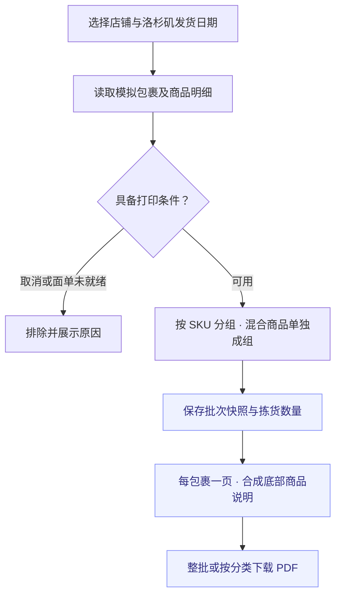
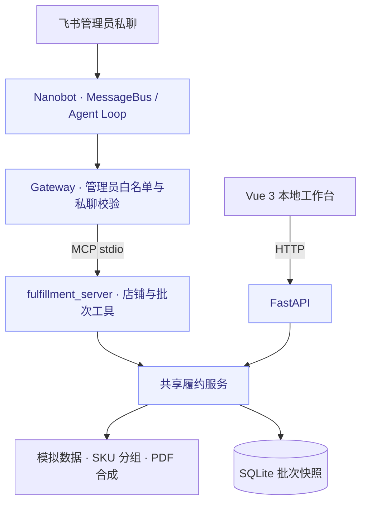

# EchoBridge · 多店铺履约工作台

面向同一品牌旗下的 20 家美国 TikTok Shop，商品由洛杉矶共享仓发出。系统将跨店订单按仓库 SKU 汇总，生成带商品名称和数量的分类面单文件。管理员可以通过本地 Web 工作台或飞书 Agent 准备和查询批次。

**技术栈**　Python · Nanobot · FastMCP · FastAPI · Vue 3 · SQLite · ReportLab / pypdf

## 业务场景与痛点

| 日常问题 | 处理方式 |
|---|---|
| 同款商品分散在多个店铺，需要逐店整理发货任务 | 按店铺、日期取数，跨店按仓库 SKU 组织批次 |
| 面单缺少仓库拣货所需的商品说明 | 在预留底部区域追加本包裹的商品名称、SKU 和数量 |
| 多件或混合商品容易漏发 | 区分包裹页数与商品件数，混合商品独立分组 |
| 重复操作容易产生不一致的打印材料 | 保存批次快照，相同输入返回同一批次 |

当前数据源模拟 **20 家美国店铺的 TikTok Shipping / USPS 包裹**，用于验证分类和排版。PDF 标明演示用途，无有效邮资。真实 TikTok API、打印机执行与退货申诉尚未接入。

## 面单处理流程



前两家示例店共有 21 个可用包裹，`pad-blk` 为 5 件、`pad-org` 为 11 件、`pad-sil` 为 5 件。全部 20 店共有 57 个可用包裹、93 件商品，覆盖多件同款与混合商品样本。批次按洛杉矶日期生成，下载使用已保存快照。

## 两个管理员入口



飞书 Agent 根据管理员请求选择工具，后端通过 `FEISHU_ADMIN_IDS` 白名单与私聊上下文校验调用身份。MCP 提供店铺列表、准备批次和查询批次三个能力。Web 与 MCP 复用同一履约服务，通过 `FULFILLMENT_SIM_DB` 指向相同数据库时可查询同一批次。Web 默认本机访问，当前没有员工登录。

Nanobot 提供模型循环、上下文与记忆管理。批次、商品数量和排除原因以服务返回的快照为准；长期记忆仅保存通用操作偏好。

## 项目目录与职责

```text
nanobot-customer-support/
├── customer_gateway.py          # 飞书管理员 Gateway 入口与工具权限校验
├── api_service.py               # FastAPI 应用与履约路由注册
├── web_server.py                # 本机 Web 与静态页面启动入口
├── start_web.sh                 # 本地 Web 启动脚本
├── fulfillment_simulator.py     # 20 店模拟包裹、SKU 分组与 PDF 合成
├── fulfillment_service.py       # Web / MCP 共用的批次服务与快照存储
├── fulfillment_api.py           # 模拟履约 HTTP 接口与 PDF 下载
├── mcp_servers/
│   └── fulfillment_server.py    # FastMCP 店铺列表、准备批次和查询工具
├── static/
│   ├── index.html               # Vue 面单工作台
│   ├── vue.global.prod.js       # 本地 Vue 运行库
│   └── tailwind-3.4.17.js       # 本地样式运行库
├── workspace/
│   ├── AGENTS.md                # 内部运营规则与执行边界
│   └── skills/fulfillment/
│       └── SKILL.md             # 面单批次工具使用指导
├── config.example.json          # 脱敏的飞书、模型和 MCP 配置模板
├── .env.example                 # 密钥与飞书管理员变量占位模板
├── requirements.txt             # Python 与 PDF 依赖
├── requirements-docker.txt      # 容器飞书依赖
├── Dockerfile / docker-compose.yml
├── deploy/                      # Gateway 容器初始化与健康检查
├── tests/                       # 权限、批次、API、MCP 与 PDF 验证
└── README.md
```

本地配置、密钥、数据库、会话和记忆数据由 Git 忽略规则排除。Docker Compose 当前运行飞书 Gateway，Web 通过独立入口运行。
