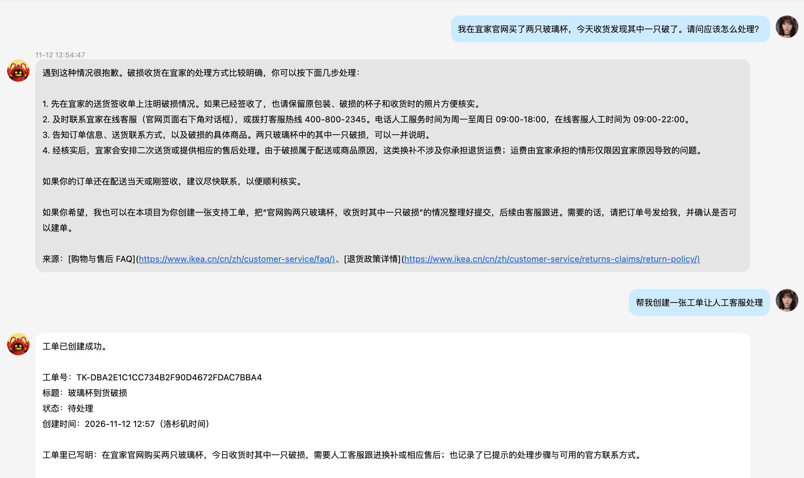
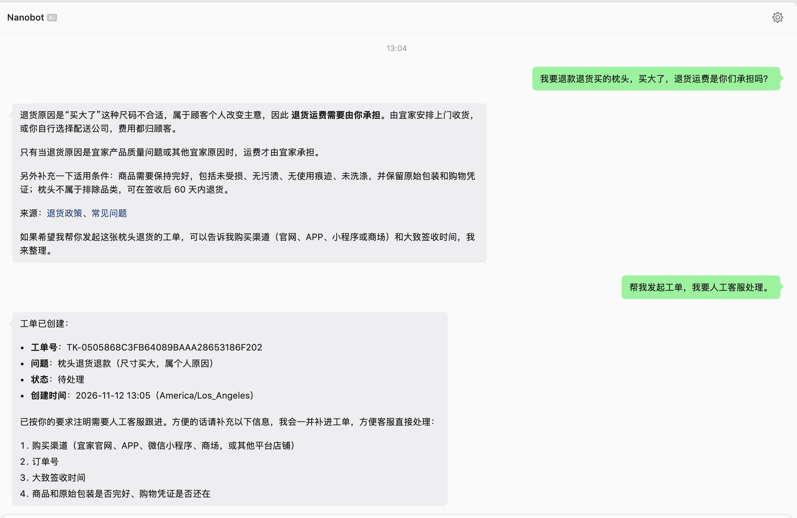
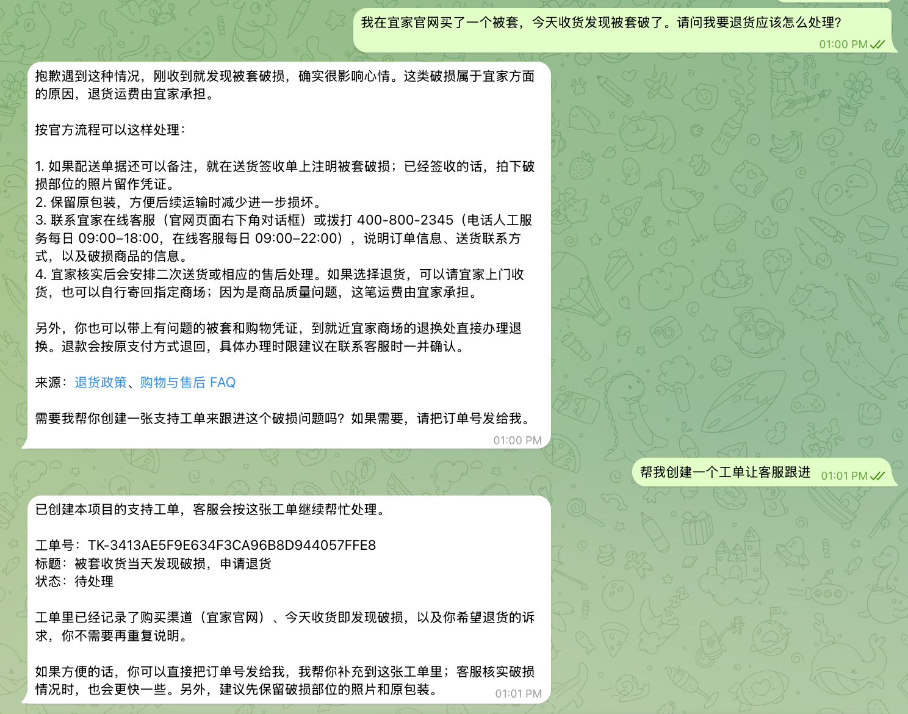
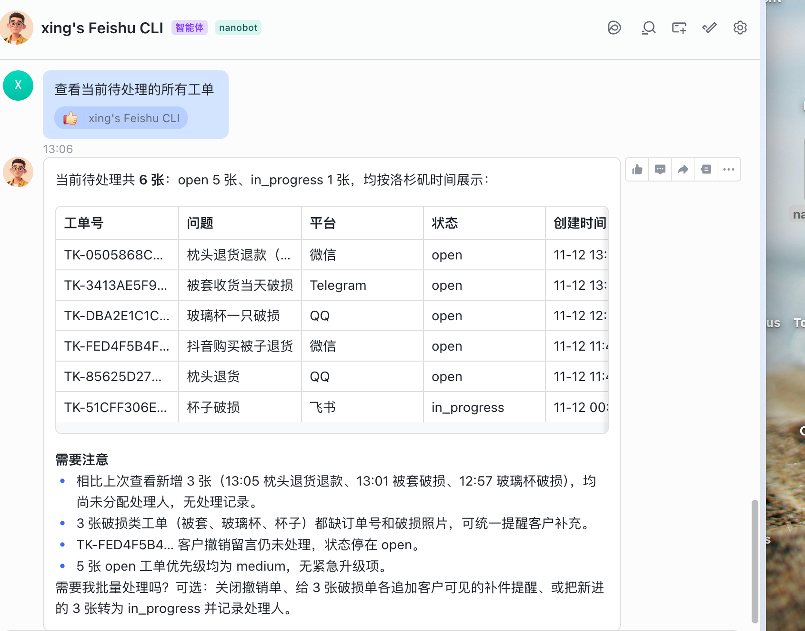
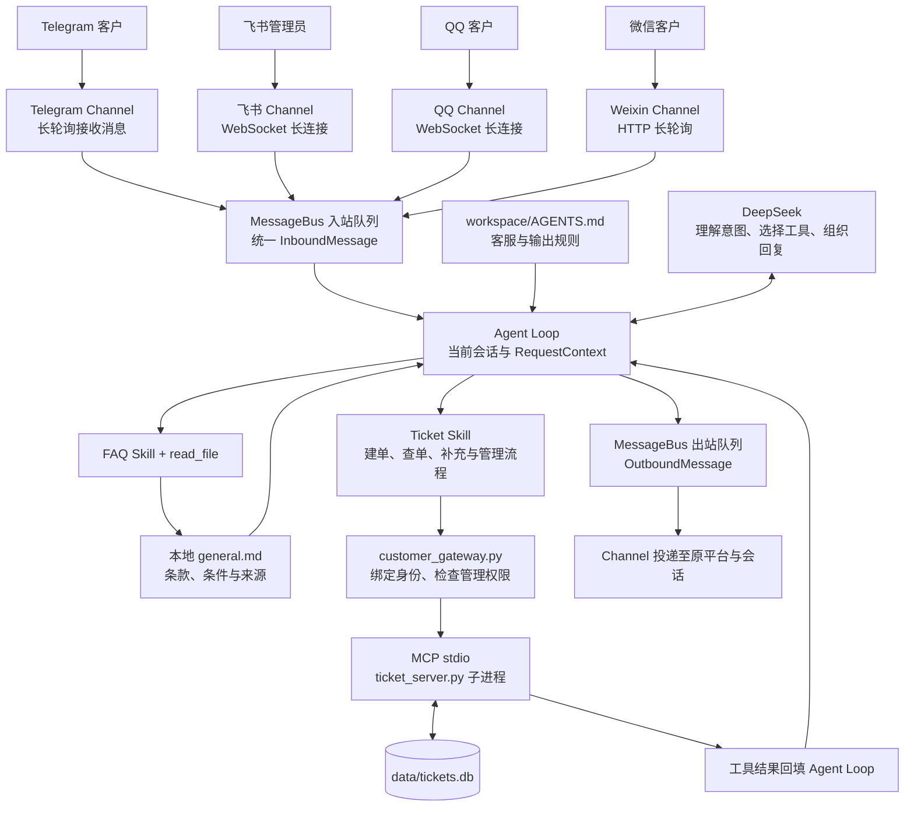
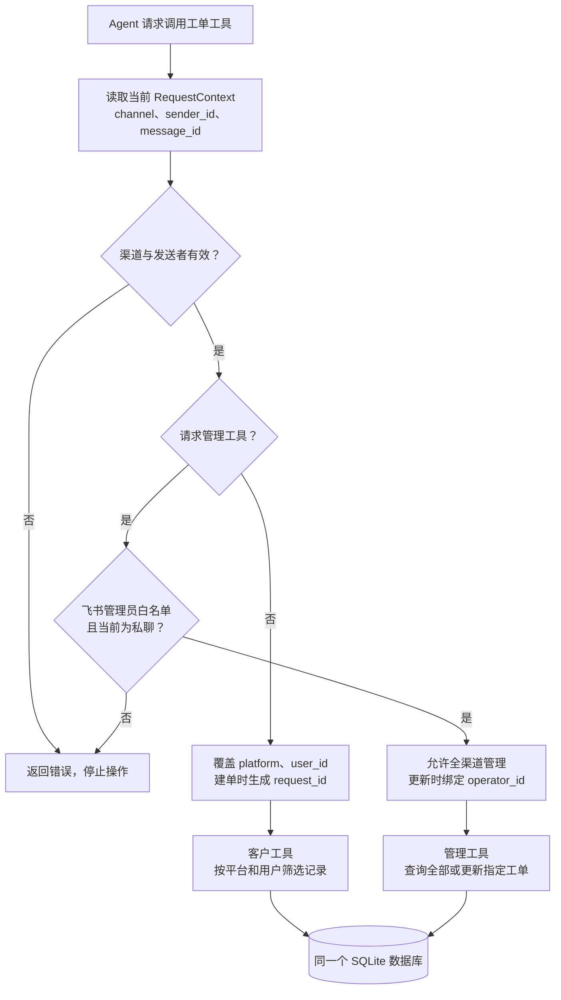

# EchoBridge 多平台智能客服系统

QQ、微信与 Telegram 接待客户，飞书管理员统一处理售后工单。

基于 Nanobot 的零售售后 Agent 实战项目。客户可以咨询商品与售后规则、确认创建工单、补充信息和查询进度。处理人员在飞书私聊中查看跨渠道待办、更新状态并添加处理备注，客户再次查询时获得最新结果。

当前已完成 QQ、微信、Telegram 客户渠道与飞书管理员的真实会话联调，自动化测试覆盖 16 个测试方法。运行需要自行配置模型和平台凭据、准备知识库并完成机器人授权。

## 产品展示

客户通过 QQ、微信或 Telegram 咨询售后问题，Agent 提供知识库指引，并在用户确认后创建支持工单；管理员通过飞书私聊统一查看和处理各平台工单。以下截图来自实际渠道联调，所创建工单属于本项目的支持流程。

### 客户端（Customer）

#### QQ：商品破损咨询与确认建单

客户描述玻璃杯到货破损，Agent 提供处理指引和来源链接；客户明确要求人工处理后，创建工单并返回编号、状态及洛杉矶本地创建时间。



#### 微信：退货运费咨询与人工升级

客户因枕头尺寸不合适咨询退货运费，Agent 说明个人原因与商品质量问题的政策区别；客户要求人工处理后，创建退货退款支持工单，并提示补充购买渠道、订单号和签收时间等必要信息。



#### Telegram：商品破损退货与上下文承接

客户反馈被套收货当天破损并希望退货，Agent 提供售后指引；用户确认建单后，沿用前文的问题描述与购买渠道创建工单，返回编号及待处理状态，减少重复询问。



### 管理员端（Admin）

#### 飞书：汇总查看跨平台待处理工单

管理员在飞书私聊中查询待处理工单，统一查看微信、Telegram、QQ 等来源的记录，按问题、平台、状态和本地创建时间汇总，并识别缺少订单号、照片等需要继续跟进的信息。



客户与管理员使用同一套工单服务。客户操作范围由真实渠道身份绑定，飞书管理员通过白名单和私聊校验获得跨平台管理权限；相关消息链路与权限流程见下方架构说明。

## 使用场景与当前进度

| 场景 | 当前能力与验证情况 |
| --- | --- |
| 知识库问答 | 按 FAQ Skill 读取本地 Markdown，结合适用条件回答并引用公开来源；已完成实际渠道问答验证 |
| 用户确认建单 | 整理商品、现象、已尝试步骤和诉求，用户确认后创建本项目的支持工单；已完成客户渠道建单验证 |
| 客户查询 | 按真实渠道和发送者筛选本人记录，支持查询状态及补充备注 |
| 飞书集中处理 | 管理员私聊查询所有平台工单、查看详情、更新状态和添加客户可见备注；已完成跨渠道查看与处理验证 |
| 权限控制 | 项目入口绑定身份并校验管理员；已在真实 Telegram 会话中验证跨用户查询和冒充管理员被拒绝 |
| 客户输出 | 关闭渠道过程提示及流式展示，以规则约束工具名、路径和内部权限信息外露；自然语言输出需持续验收 |
| 数据持久化 | SQLite 保存工单及处理记录，已有记录重新打开及旧表迁移有自动化测试 |

## 系统如何工作

### 消息从用户到回复的完整链路

Nanobot 提供 Channel、MessageBus 和 Agent Loop。本项目增加客服规则、Skills、工单服务，以及工单工具的可信身份绑定。



MessageBus 使用 Nanobot 进程内的异步队列。Channel 负责平台消息格式转换，Agent Loop 将工具结果加入上下文后继续决策，最后通过出站队列回复。数据库保存业务事实，会话历史帮助理解追问。

Skill 由模型读取，用于指导操作顺序和判断条件。身份绑定、权限拒绝及数据库写入由程序执行。相同问题的知识内容已经位于会话上下文时，后续回答可能复用已有内容。

### 工单身份与管理员权限



模型的工具参数中隐藏 platform、user_id、operator_id 和建单 request_id。项目入口从当前请求覆盖身份字段，即使调用参数试图指定其他用户，也会按真实发送者执行。角色查询工具返回当前请求的访问范围，帮助 Agent 在本人列表与全渠道列表之间选择。

管理员名单由本地环境变量 TICKET_ADMIN_FEISHU_IDS 配置。管理员工具在每次执行前校验飞书渠道、发送者和私聊条件。普通客户通过本人查询读取状态与公开处理备注。

## 项目目录与文件职责

以下路径均相对于项目根目录。真实配置、知识库正文及运行数据仅在本地保存，未上传 GitHub；仓库中提供对应配置模板和代码。

```text
nanobot-customer-support/
├── customer_gateway.py              # 项目启动入口与身份、权限扩展
├── config.example.json              # 可发布的配置模板，路径为占位内容
├── .env.example                     # 可发布的凭据和管理员变量模板
├── config.json                      # 本地运行配置
├── .env                             # 本地密钥、平台凭据和管理员 ID
├── requirements.txt                 # 固定核心依赖版本
├── requirements-docker.txt          # 容器使用的可选渠道依赖
├── Dockerfile                       # Python 环境、源码与非 root 运行用户
├── docker-compose.yml               # 服务、环境变量、健康端口与持久化卷
├── .dockerignore                    # 构建上下文白名单，排除密钥和业务数据
├── deploy/
│   ├── config.docker.json           # 容器专用配置模板，无真实凭据
│   ├── entrypoint.py                # 首次初始化运行配置，重启保留已有配置
│   └── healthcheck.py               # Gateway readiness 检查
├── README.md                        # 架构、运行和验收说明
├── docs/images/                     # QQ、微信、Telegram 客户端与飞书管理员截图
├── .gitignore                       # 本地配置及运行数据排除规则
├── mcp_servers/
│   ├── ticket_server.py             # MCP 工具、TicketStore 和人工 CLI
│   └── LICENSE.learn-nanobot        # MIT 许可声明
├── tests/
│   ├── test_ticket_server.py        # 协议、存储、迁移、输入及并发测试
│   ├── test_ticket_identity.py      # 真实 MCP 调用的身份和管理权限测试
│   └── test_container_deployment.py # 配置初始化、重启保留与渠道依赖检查
├── workspace/
│   ├── AGENTS.md                    # 客服规则、输出约束和角色分流
│   ├── skills/
│   │   ├── faq/SKILL.md             # 知识库读取、来源引用和人工升级流程
│   │   └── ticket/SKILL.md          # 角色识别及客户、管理员工具使用流程
│   ├── knowledge/ikea/              # 本地验证资料，未随仓库分发
│   │   ├── general.md              # 合并的 FAQ 与退货政策
│   │   ├── sources.json             # 来源、抓取时间和校验值
│   │   └── README.md                # 本地资料说明
│   ├── memory/                     # 本地长期记忆
│   ├── USER.md                     # 本地用户信息
│   ├── SOUL.md                     # 本地表达风格
│   ├── HEARTBEAT.md                # 本地周期任务说明
│   ├── prompts/                    # 本地提示词覆盖
│   ├── cron/                       # 本地任务数据
│   ├── triggers/                   # 本地触发器数据
│   └── .nanobot/                   # workspace 运行数据
├── data/tickets.db                 # 本地工单数据库
├── sessions/                       # 本地聊天历史，位于 workspace 外
├── pairing.json                    # 本地渠道用户配对记录
├── weixin/account.json             # 本地微信登录状态，未上传 GitHub
├── logs/                           # 本地运行日志，可能包含业务内容
├── media/                          # 本地消息附件
├── llm_usage.sqlite3               # 本地模型用量记录
├── config.json.lock                # 配置写入锁
└── cache/、cli-apps/、run/、webui/   # 本地框架运行目录
```

真实配置与密钥、知识库正文、工单数据库、聊天历史、配对记录、个人资料及日志在本地保存，已通过 Git 忽略规则排除。运行前需要自行填写配置模板并准备知识资料。

### 框架内部路径

以下路径属于已安装的 Nanobot 依赖，相对于 Python site-packages，可以用于定位消息处理流程。

| 框架路径 | 职责 |
| --- | --- |
| nanobot/channels/telegram/runtime.py | Telegram 收发与消息适配 |
| nanobot/channels/feishu/runtime.py | 飞书长连接、事件和回复适配 |
| nanobot/channels/manager.py | 渠道管理、出站分发及过程提示策略 |
| nanobot/bus/events.py | 入站和出站消息的数据结构 |
| nanobot/bus/queue.py | MessageBus 异步入站与出站队列 |
| nanobot/agent/loop.py | 上下文与模型、工具执行循环 |
| nanobot/agent/tools/context.py | 请求级上下文与发送者身份 |
| nanobot/agent/tools/mcp.py | MCP 连接、工具注册及调用包装 |

customer_gateway.py 在进程内扩展 MCPToolWrapper。升级依赖后需要重新执行身份集成测试，验证内部接口兼容性。

## MCP 工具与业务状态

启用管理能力后共注册 8 个工具，Nanobot 注册名带有 mcp_ticket_server_ 前缀。

| 工具 | 用途与范围 |
| --- | --- |
| get_ticket_access_context | 程序根据当前请求返回角色与查询范围 |
| create_ticket | 用户确认后创建工单，重试复用消息对应的幂等标识 |
| get_ticket | 查询当前渠道用户的指定工单 |
| list_user_tickets | 分页查询当前用户记录，可按状态过滤 |
| add_ticket_comment | 为本人工单追加客户说明 |
| admin_list_tickets | 飞书管理员私聊查询全部平台的工单 |
| admin_get_ticket | 飞书管理员查看指定工单详情 |
| admin_update_ticket | 飞书管理员更新状态或添加备注，记录处理人 |

工单包含标题、描述、分类、平台、用户、订单号、商品名、优先级、状态、时间与公开处理记录。分类覆盖退货、换货、退款、配送、破损、少件及其他问题。状态为 open、in_progress、resolved 和 closed。

create_ticket 在同一事务中检查 request_id 与内容指纹。相同请求返回原工单，内容冲突返回错误。更新备注使用写事务，避免并发读改写覆盖其他处理记录。追加备注在超时后需要先查询确认是否已经写入。

## 安全设计与测试

已实现的控制包括可信渠道身份绑定、客户工单范围隔离、飞书管理员私聊权限校验、SQL 参数化、建单幂等与事务更新。自动化测试同时检查伪造身份、越权管理和并发访问等场景。

当前共有 16 个测试方法，使用临时数据库、模拟渠道身份和真实 MCP stdio 子进程。在安装依赖的 Python 环境中执行测试。

```bash
python -m unittest discover -s tests -v
```

测试按以下流程组织，后续随功能补充具体用例和验收记录。

1. 工具与存储测试，检查输入、SQL 参数绑定、数据持久化、重试和并发一致性。
2. 身份与权限测试，检查客户、管理员及跨平台操作的访问范围。
3. 端到端链路测试，检查知识库回答、用户确认建单、人工处理、客户回查与重启后的记录恢复。
4. 对抗与输出测试，逐步补充提示注入、重复受限请求和内部信息外露场景。

当前已完成部分真实渠道联调。提示注入全面评估、客户自然语言输出及完整部署验收仍需完善，测试结论以实际用例覆盖范围为准。

## 部署与运行

### Docker 部署

需要安装并启动 Docker Engine / Docker Desktop，且 `docker compose` 命令可用。容器自动运行 `customer_gateway.py`，启动 Nanobot Gateway 与工单 MCP 子进程，无需另行执行 `nanobot gateway`。

QQ、微信和 Telegram 为客户渠道，飞书为管理员渠道。各平台使用长连接或轮询接入，本部署不需要公网 Webhook、域名或反向代理；通过飞书私聊处理工单，不开放 WebUI 端口。

`docker-compose.yml`：

```yaml
services:
  customer-service-bot:
    build: .
    image: echobridge:local
    restart: unless-stopped
    init: true
    env_file:
      - .env
    environment:
      TZ: ${TICKET_TIMEZONE:-America/Los_Angeles}
      TICKET_TIMEZONE: ${TICKET_TIMEZONE:-America/Los_Angeles}
    ports:
      # Health endpoint only; do not publish WebUI or administration interfaces.
      - "127.0.0.1:18792:18790"
    volumes:
      - customer-runtime:/runtime
      - customer-memory:/app/workspace/memory
      - ./workspace/knowledge:/app/workspace/knowledge:ro
    stop_grace_period: 30s
    logging:
      driver: json-file
      options:
        max-size: "10m"
        max-file: "3"

volumes:
  customer-runtime:
  customer-memory:
```

`.env` 提供模型和平台凭据；`customer-runtime` 保存工单、运行配置、配对、微信登录和会话，`customer-memory` 保存长期记忆；本地知识库只读挂载到容器。镜像不包含真实密钥、知识库正文或运行数据。

| 文件 | 作用 |
| --- | --- |
| `Dockerfile` | 构建 Python、Nanobot、渠道依赖及项目代码的运行镜像 |
| `requirements-docker.txt` | 固定飞书、Telegram、QQ、微信使用的可选依赖 |
| `.dockerignore` | 通过构建白名单排除本地密钥和业务数据 |
| `deploy/config.docker.json` | 容器配置模板，使用环境变量引用与容器路径 |
| `deploy/entrypoint.py` | 首次初始化运行配置，后续启动保留已有配置 |
| `deploy/healthcheck.py` | 检查 Gateway readiness，供 Docker 显示健康状态 |

容器代码和客服规则位于 `/app/`，workspace 为 `/app/workspace/`，运行配置为 `/runtime/config.json`，工单数据库为 `/runtime/data/tickets.db`，微信登录状态位于 `/runtime/weixin/`。运行配置与聊天历史位于 workspace 外。工单原始时间以 UTC 保存，工具另外提供按 `TICKET_TIMEZONE` 转换的本地时间字段；回复使用本地字段，自动处理夏令时，历史数据无需重写。

已完成 Linux ARM64 镜像构建、容器内 16 项自动化测试、四个业务渠道连接、8 项 MCP 能力注册、真实模型回复及重启后的数据保留验证。完整业务验收仍按下方客户与管理员操作流程进行。

### 部署步骤

**1. 获取项目，准备知识库**

```bash
git clone https://github.com/tommie-04/EchoBridge.git
cd EchoBridge
mkdir -p workspace/knowledge/ikea
```

将 FAQ 文档放到 `workspace/knowledge/ikea/general.md`。当前 FAQ Skill 按该路径读取，仓库不分发验证用的知识库正文。替换产品场景时，同步修改 `workspace/skills/faq/SKILL.md` 中的路径与业务描述。

**2. 配置环境变量**

首次部署复制模板，随后编辑 `.env`；已有 `.env` 时，下面的命令不会覆盖它。

```bash
cp -n .env.example .env
```

填写以下变量：

| 环境变量 | 用途 |
| --- | --- |
| `CUSTOMER_SUPPORT_API_KEY` | DeepSeek API Key，模板使用 `deepseek-flash` |
| `TELEGRAM_BOT_TOKEN` | Telegram Bot Token |
| `QQ_APP_ID` / `QQ_APP_SECRET` | QQ 机器人凭据 |
| `FEISHU_APP_ID` / `FEISHU_APP_SECRET` | 飞书应用凭据 |
| `TICKET_ADMIN_FEISHU_IDS` | 飞书管理员 Open ID，多个值以英文逗号分隔 |
| `TICKET_TIMEZONE` | 工单显示时区，默认 `America/Los_Angeles`，也可设置为 `Asia/Shanghai` 等 IANA 时区 |

四个业务渠道默认启用，微信通过下一步扫码获取登录状态。新实例若需要停用某渠道，在首次启动前修改 `deploy/config.docker.json` 中该渠道的 `enabled`。

**3. 构建镜像，完成微信登录**

切换部署前，停止使用同一组机器人账号的本地 Gateway。容器使用独立数据卷，不会自动迁入本地工单、配对或登录状态；已有实例迁移需要另外备份、导入。

```bash
docker compose config --quiet
docker compose build
docker compose run --rm customer-service-bot nanobot channels login weixin --config /runtime/config.json
```

按终端提供的链接或二维码授权，微信登录状态保存在数据卷中，后续启动通常无需重新扫码。授权失效时先停止服务，再执行登录命令。

**4. 启动服务并检查状态**

```bash
docker compose up -d
docker compose ps
docker compose logs --tail=100 customer-service-bot
curl --fail http://127.0.0.1:18792/health
```

`-d` 表示后台运行，关闭终端不影响服务。`healthy` 和 `ready: true` 表示 Gateway 就绪，还需在日志中确认各平台已连接、工单 MCP 注册成功。健康端口只绑定宿主机 `127.0.0.1:18792`。

**5. 完成首次用户配对**

从客户平台和飞书私聊 Bot，获得配对码后，在同一容器实例中批准自己的请求，再重新发送消息。将示例代码替换为实际配对码。

```bash
docker compose exec customer-service-bot nanobot agent --config /runtime/config.json -m "/pairing approve ABCD-EFGH"
```

配对允许用户使用 Bot。飞书管理员还需满足 `TICKET_ADMIN_FEISHU_IDS` 白名单及私聊条件；客户渠道用户不会因此获得管理员权限。

**6. 验证业务链路和持久化**

分别在 QQ、微信、Telegram 测试 FAQ 解答、创建工单和本人回查；在飞书管理员私聊中查看所有平台工单，更新状态与处理备注，再由客户回查结果。

```bash
docker compose restart customer-service-bot
docker compose ps
curl --fail http://127.0.0.1:18792/health
```

等待服务恢复健康后，查询原工单，确认状态、处理记录和配对保留。

### 日常运行与更新

| 操作 | 命令 |
| --- | --- |
| 启动或恢复服务 | `docker compose up -d` |
| 查看状态 | `docker compose ps` |
| 持续查看日志 | `docker compose logs -f --tail=50 customer-service-bot` |
| 重启服务 | `docker compose restart customer-service-bot` |
| 停止服务 | `docker compose stop` |
| 修改 `.env` 后加载新环境变量 | `docker compose up -d --force-recreate` |
| 修改源码、AGENTS 或 Skills 后构建并更新 | `docker compose up -d --build` |
| 删除容器和网络，保留数据卷 | `docker compose down` |

`deploy/config.docker.json` 只在数据卷中尚无运行配置时复制。修改模板不会覆盖已有实例；已有实例需先停止服务，单独更新数据卷中的 `/runtime/config.json`，然后重新启动。不要用 `docker compose down -v` 做普通停止操作，该命令会删除命名卷及其中的业务数据。

宿主机和 Docker 引擎需要保持运行；电脑休眠、关机或退出 Docker Desktop 会中断服务。需要持续在线时，可将相同配置部署到常驻服务器。切换回本地开发前先停止容器，避免两个 Gateway 同时接收同一机器人账号的消息。
